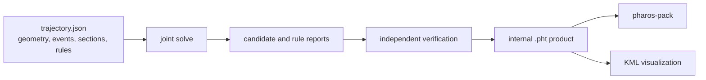

# Trajectories

A trajectory plan is the authored description of a receiver's journey.
It names geometry, events, sections and rules in `trajectory.json`.
Pharos solves positions, motion and timing together, reports the result,
and writes a verified `.pht` product for `pharos-pack`.



The JSON plan is the authoring format. `.pht` is the solved product;
LLA and ECEF position logs are observation outputs and are not trajectory
inputs. The model and numerical limits are described in
[design: trajectories](../design/trajectories.md).

## Commands

```
pharos-traj build <trajectory.json> [-o <FILE>] [--name <TEXT>]
pharos-traj static (--lla <LAT,LON,ALTITUDE> | --ecef <X,Y,Z>) --duration <SECONDS> -o <FILE> [--name <TEXT>]
pharos-traj info <file.pht>
pharos-traj check <file.pht>
pharos-traj export <file.pht> [-o <FILE>]
```

| Command | Result |
|---|---|
| `build` | solves the plan, prints its report and writes `.pht` only after verification; default output replaces `.json` with `.pht` |
| `static` | creates a receiver at rest from coordinates and a duration; `-o` is required |
| `info` | prints the internal product's name, knot count, duration and endpoints |
| `check` | reports sampled speed, acceleration, jerk, altitude and derivative steps |
| `export` | writes a KML visualization; default output replaces `.pht` with `.kml` |

`--name` overrides the plan's name or names a static product. `--lla`
uses degrees and metres above EGM96; `--ecef` uses WGS84 ECEF metres.
`--duration` is in seconds, from 0 to 10^7. The static factory is also
available to C hosts. `build` has one source model and no kind selector.

```bash
pharos-traj build examples/trajectories/wuhan_drive.json
pharos-traj build examples/trajectories/wuhan_route.json -o guide.pht
pharos-traj check guide.pht
pharos-traj export guide.pht
```

## Plan structure

| Key | Content |
|---|---|
| `format` | required `"pharos.trajectory-plan"` |
| `version` | required `1` |
| `name` | optional string, default empty |
| `coordinates` | required `{ "datum": "WGS84", "altitude": "EGM96" }` or altitude `"ellipsoid"` |
| `geometry` | named points and optional curves and regions |
| `events` | at least two events in increasing time order; the first is at time zero |
| `sections` | the ordered chain joining each pair of consecutive events |
| `rules` | hard constraints, soft targets and objectives |
| `initialGuess` | optional starting times and states for the solver |

Every named object has a nonempty stable `id`. References use those
identifiers. The reader rejects missing references, duplicate identifiers,
invalid parameter combinations and an inconsistent section chain.

### Geometry

A point is `{ "id": "A", "position": { "latitude": 30.5292,
"longitude": 114.3642, "altitude": 40 } }`. Latitude and longitude are
in degrees; altitude uses the plan's reference. The reader resolves the
position into WGS84 ECEF coordinates.

| Geometry array | Entry |
|---|---|
| `points` | required array of named geodetic positions |
| `curves` | `{ "id": "guide", "type": "bezier", "points": ["A", "H1", "H2", "B"] }`; `polyline` is also supported |
| `regions` | `{ "id": "area", "type": "circle", "center": "A", "radius": 100 }`, or a convex `polygon` with ordered point IDs |

Bezier guides are cubic chains in ECEF and require `3n+1` control
points. A polyline needs at least two points. Regions use a local ENU
frame and metres. Geometry constrains the journey when a rule refers
to it; adding a guide alone does not make the receiver follow it.

### Events and sections

An event is `{ "id": "arrive", "continuity": "C2" }`. Continuity
specifies which incoming and outgoing translational variables are shared:

| Continuity | Shared translational state at the event |
|---|---|
| `C0` | position |
| `C1` | position and velocity |
| `C2` | position, velocity and acceleration; the default |

When orientation is active, course and turn rate are shared across
events for every continuity setting.

A section is `{ "id": "travel", "from": "start", "to": "finish" }`.
Its endpoints are events; its duration and motion follow the rules.
Event order is fixed while event times can move. A fixed duration or
arrival time requires a hard rule. Starting or ending at rest likewise
requires a velocity or speed rule.

A dwell uses two events and a section between them. Constrain that
section's position to a point or its `speed3d` to zero, and constrain or
target its duration. Position and altitude remain constant during a
stationary section. Continuity at its endpoints controls the approach
and departure.

### Rules

Every rule has `id`, `kind` and `scope`, plus a quantity or relation.
`scale` is a positive physical normalization scale, default 1. Soft
rules also use positive `weight`, default 1.

| Kind | Additional keys | Meaning |
|---|---|---|
| `hard` | exactly one of `eq` or `range` | required equality or inclusive bounds |
| `target` | `value` | a weighted preference; it may retain a residual |
| `objective` | optional `reduce` and `sense` | minimizes or maximizes a quantity or its squared reduction |

A range gives `min`, `max` or both. An objective's `sense` is `minimize`
by default. Its `reduce` is `value`, `meanSquare` or `integralSquare`;
`integralSquare` requires an interval scope. At an event or fixed time,
`meanSquare` is the squared value. A vector objective uses a squared
reduction. Hard rules are checked independently after solving.

```json
{
  "id": "arrival",
  "kind": "hard",
  "scope": { "event": "finish" },
  "quantity": "time",
  "eq": 40
}
```

```json
{
  "id": "smooth-motion",
  "kind": "objective",
  "scope": { "all": true },
  "quantity": "jerk3d",
  "reduce": "integralSquare",
  "scale": 1,
  "weight": 1
}
```

| Scope | Applies to |
|---|---|
| `{ "event": "arrive", "side": "in" }` | the incoming event state; omitted `side` means `out` |
| `{ "section": "travel" }` | one section |
| `{ "between": ["start", "finish"] }` | the interval between two events |
| `{ "time": 10 }` | a fixed elapsed time |
| `{ "timeRange": [10, 20] }` | a fixed elapsed-time interval |
| `{ "all": true }` | the whole journey |

A scope selects exactly one of these forms. `duration` requires an
interval. Event scopes remain attached to events as timing changes;
fixed-time scopes remain attached to elapsed seconds.

### Quantities and values

| Quantity | Unit and meaning |
|---|---|
| `time`, `duration` | seconds |
| `position` | ECEF metres; a named point is the usual value |
| `velocityEcef`, `accelerationEcef` | three components in m/s and m/s^2 |
| `speed3d`, `horizontalSpeed` | nonnegative 3D and local horizontal speed, m/s |
| `forwardSpeed` | signed speed along the solved course, m/s |
| `forwardAcceleration`, `forwardJerk` | time derivatives of forward speed, m/s^2 and m/s^3 |
| `climbRate`, `verticalAcceleration` | derivatives of altitude in the plan's reference, m/s and m/s^2 |
| `acceleration3d`, `jerk3d` | magnitudes of the ECEF vectors, m/s^2 and m/s^3 |
| `altitude` | metres in the plan's altitude reference |
| `course`, `turnRate` | course clockwise from north in degrees, and its rate in degrees/s |
| `lateralAcceleration` | signed local acceleration perpendicular to the course, m/s^2 |
| `turnRadius` | signed radius in metres: forward speed divided by turn rate expressed in radians/s |

Course is solved when a rule uses a heading or forward/lateral quantity,
including an event reference, or the initial guess supplies a course.
For a plan using only translation quantities, inspection derives course
and turn rate from horizontal velocity where it is nonzero. At rest,
inspection retains the initialized course state.

For a hard `turnRadius` equality, zero forward speed and zero turn rate
are accepted together as a stationary extension. At nonzero turn rate,
verification checks the actual signed radius using the rule's scale.
Radius ranges, targets and objectives require a nonzero turn rate.

A scalar quantity takes a number. Vector quantities take three ECEF
components. A position can use `{ "point": "A" }`. A value may also
refer to another event, for example `{ "event": "arrive", "quantity":
"speed3d", "side": "in", "factor": 1, "offset": 0 }`. The reader
checks compatible dimensions and component counts. `factor` and
`offset` default to 1 and 0.

### Geometric relations

A hard or target rule can give `relation` instead of quantity keys:

| Relation | Parameters |
|---|---|
| `followCurve` | `curve`, optional `from` and `to` in [0, 1], and nonnegative `tolerance` in metres; defaults 0, 1 and 0 |
| `insideRegion` | `region` |

A curve parameter describes progress along its geometric pieces; it is
not a distance in metres. The solver resolves progress and timing with
the other rules. A zero curve tolerance requires the guide itself;
a positive tolerance permits a corridor around it.

### Initial guess

`initialGuess.eventTimes` maps event IDs to starting times. Its `states`
array gives `event` plus optional `position`, `velocityEcef`,
`accelerationEcef` and `course`. These values seed the local solve.
They are not constraints: use rules for values that must be held.
Different starting guesses can reach different local solutions.

## Solve report

The CLI prints status, iteration count, objective, maximum violation
and stationarity. The C API's inspection additionally gives each rule's
violation, residual and active state, plus the candidate's events,
sections and samples ([source inspection](c-api/traj.md#source-inspection)).

| Status | Meaning |
|---|---|
| `converged` | the local solver converged and the candidate passed verification |
| `iterationLimit` | the numerical solve stopped before convergence because a budget ended or progress stalled, with no independent feasibility violation detected |
| `infeasible` | the current solve did not achieve feasibility |
| `numericalFailure` | the initial numerical evaluation failed |
| `verificationFailed` | numerical solving converged, but independent verification remained unresolved or the shared trajectory checks failed |

`feasible` means no hard constraint or receiver-domain violation was
detected; interval verification can still remain unresolved. `verified`
also requires numerical convergence and completed independent checks.
An infeasible result is not a proof that the authored plan has no
solution. A converged local result does not establish a global optimum. A failed solve's
candidate remains available for inspection; `.pht` serialization and
CLI output require verification.

`zig build wasm` installs `trajectory.schema.json` beside `pharos_traj.wasm`.
The schema is generated from the plan reader and supplies field types,
units, defaults and descriptions. Cross-reference and physical checks
still belong to Pharos.

## The .pht file

A `.pht` product is UTF-8 JSON Lines. Its header names `format: "pht"`,
`version: 1`, `frame: "ECEF"`, `interpolation: "quintic-hermite"`, and
columns `["t","x","y","z","vx","vy","vz","ax","ay","az"]`.
Each following line is one knot: elapsed seconds, ECEF position,
velocity and acceleration. An optional header `name` names the product.

Between knots, a quintic Hermite polynomial matches both endpoint
positions, velocities and accelerations. Two knots at one time encode
a velocity or acceleration step with the same position. Beyond the
stored interval the end knot's acceleration continues. The writer
prints numbers that read back to the same bits.

## Limits and messages

| Limit | Value |
|---|---|
| source or internal product bytes | at most 1 GiB for CLI file input |
| product duration | at most 10^7 s |
| distance from the geocentre | 6350 km to 200 000 km |
| 3D speed | at most 20 000 m/s |
| 3D acceleration | at most 1000 m/s^2 |

Diagnostics carry the source, logical field path, optional line and
column, severity and message. Invalid JSON or references produce no
candidate. Numerical failure or failed verification can retain a
candidate with a truthful solve report. The receiver-domain checker
also bounds each emitted Hermite interval; endpoints within the domain
alone are insufficient.

`check` is a sampled report of an existing internal product. It does not
reconstruct the plan's rules or replace verification during `build`.
