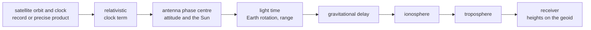

# Models

These pages cover the physics between a satellite and the receiver. Each
model is a pure function of the instant and the state. Each follows one
published document and stops at a stated boundary instead of
extrapolating past it. This page is the outline.

| Model | Computes | Follows | Chosen by | Stops at | Page |
|---|---|---|---|---|---|
| orbit and clock | the satellite's state and clock at transmit time | each system's ICD; the precise product | the navigation files; `precise` | the record's window; the product's samples | [geometry](geometry.md) |
| relativistic clock term | the periodic clock correction | each ICD; the product convention | always | the orbit it reads | [geometry](geometry.md) |
| light time | transmit time, range and line of sight | the exact Earth rotation over the light time | always | three Newton iterations | [geometry](geometry.md) |
| gravitational delay | the Earth's Shapiro delay | IERS Conventions (2010) 11.1 | always | the Earth's monopole | [geometry](geometry.md) |
| ionosphere | the slant delay at L1, scaled to each carrier | the GPS and BDS ICDs; NeQuick G; BDGIM | `ionosphere` | each model's own domain | [ionosphere](ionosphere.md) |
| troposphere | the hydrostatic and wet slant delays | GPT3 and VMF3 | always | 3 degrees of elevation | [troposphere](troposphere.md) |
| geoid | the geoid height under a point | EGM96 | always | the grid's resolution | [geoid](geoid.md) |
| phase centres | each band's offset along the line of sight | ANTEX 1.4 | `antenna` | per-band offsets; no variations | [antennas](antennas.md) |
| attitude | the satellite's body axes | one yaw law per block | the ANTEX antenna type | a closed form of the instant | [antennas](antennas.md) |

## Where the models act

The knot stage evaluates the slow terms once a second: the ionosphere,
the troposphere, elevation, azimuth and the phase-centre ranges. An epoch
takes the chord between two knots. The light time, the clock and the
gravitational delay are evaluated at every epoch.

| Term | Code | Carrier |
|---|---|---|
| range after the light time | added | added |
| gravitational delay | added | added |
| troposphere | added | added |
| ionosphere, scaled to the carrier | added | subtracted |
| phase-centre offset of the band | added | added |
| satellite clock, with its relativistic term | subtracted | subtracted |
| group delay | the component's own | the band's reference code |

The observation file and the samples read the same terms, so a receiver
of the samples measures the observation file's values.

| Page | Covers |
|---|---|
| [Geometry](geometry.md) | orbits and clocks, the relativistic term, light time, the gravitational delay, precise-product conventions, datums |
| [Ionosphere](ionosphere.md) | the five concrete models, automatic selection by constellation, coefficients and fallbacks, scaling, domains, what the messages broadcast |
| [Troposphere](troposphere.md) | GPT3 meteorology, VMF3 mapping, the 3-degree floor, the embedded grids |
| [Geoid](geoid.md) | the EGM96 grid, its interpolation, where altitudes are used |
| [Antennas](antennas.md) | phase-centre offsets, the body frame, the attitude laws, the Sun |

The system-specific parts live in the constellation pages. The yaw laws'
parameters, for example, are in each system's overview, such as
[BDS](../gnss/bds/README.md).
