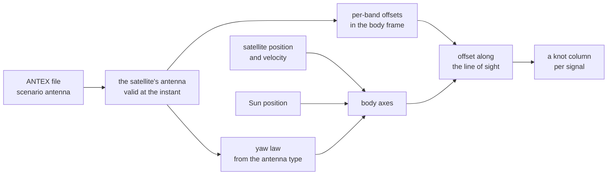

# Antennas and attitude

A broadcast orbit describes one point of the satellite: the phase centre
of the ionosphere-free pair its clock is stated on. With an ANTEX file,
each signal leaves from its own band's phase centre instead. Where that
point lies depends on the satellite's attitude, which Pharos models with
one yaw law per block.

## Phase-centre offsets

The reference point is the pair's frequency-weighted offset,
(f1^2 o1 - f2^2 o2) / (f1^2 - f2^2). A signal adds the projection of its
band's offset less the reference on the line of sight. The same term
enters code and carrier.

| Case | Where a signal leaves from |
|---|---|
| no `antenna` key | the point the orbit describes |
| a broadcast orbit, with an antenna | its band's phase centre: the orbit's point plus its band's offset less the reference |
| a precise product, with an antenna | the product's centre of mass moved to the reference point, then as above |
| the file gives the band no offset | the reference point |
| the file gives the pair no offset | the orbit's point; for a product, its centre of mass |
| several antennas for the satellite | the one valid at the instant with the latest start |

The pair is the product's `clockReference`, else the system's default
([geometry](geometry.md)). The ANTEX code of each signal is in
[navigation data](../guide/navigation-data.md). The offsets resolve once
per selection and ride as a knot column. The antenna belongs to the
satellite, so a record change does not blend it.

## The body frame

| Axis | Direction |
|---|---|
| +z | toward the Earth's centre |
| +x | the along-track direction turned by the yaw angle towards the cross-track one |
| +y | completing the right-handed set: z cross x |

At zero yaw, +x lies along the velocity and +y along the negative orbit
normal.

## Attitude

Attitude is read only by the phase-centre offsets. Away from orbit noon
and midnight every satellite yaw-steers: the Sun and the orbit plane fix
its axes. Through a turn the nominal law asks for half a turn of yaw at
once, which no satellite follows. Each law says what a block does
instead.

The packer picks the law per satellite from the ANTEX antenna type. The
bundle carries it, so no consumer matches a string. A type that no row
covers flies the nominal law, and the packer warns. Every law is a
closed form of the instant, so no epoch depends on another.

| Law | What it does | Blocks | Parameters and sources |
|---|---|---|---|
| nominal | yaw steering alone; a step through each turn | a type no row covers | none |
| rate-limited | slews at a fixed rate where the nominal law turns faster | GPS blocks; GLONASS types other than GLONASS-M | [GPS](../gnss/gps/README.md), [GLONASS](../gnss/glonass/README.md) |
| shadowed | a noon turn centred on noon; a midnight turn from umbra entry, then held | GLONASS-M | [GLONASS](../gnss/glonass/README.md) |
| smoothed | at a low Sun, the turn smoothed to a cosine of a fixed period | Galileo FOC | [Galileo](../gnss/galileo/README.md) |
| auxiliary | steering on an auxiliary Sun direction near the turns | Galileo IOV | [Galileo](../gnss/galileo/README.md) |
| Sun-elevation floor | the Sun's elevation held at a floor or above | BDS-3 IGSO and MEO | [BDS](../gnss/bds/README.md) |
| orbit-normal below a threshold | yaw steering above a Sun elevation, orbit-normal below | BDS-2 IGSO and MEO | [BDS](../gnss/bds/README.md) |
| orbit-normal | zero yaw, always | BDS GEO | [BDS](../gnss/bds/README.md) |

The laws share one geometry: three axes, the Sun's elevation above the
orbit plane and the satellite's angle from orbit midnight. The axes point
to nadir, along track and across track. A turn folds onto the nearer of
midnight and noon, so one nominal formula serves both. A rate-limited
slew starts where the nominal rate reaches the limit. It ends where it meets the nominal yaw again,
found by a fixed number of halvings. At a limit of twice the orbit rate
or less, the law keeps the nominal yaw.

## The Sun

The Sun's direction follows the Astronomical Almanac's low-precision
formulae. The Earth's rotation uses the IAU 1982 sidereal time, with UT1
taken as UTC on the built-in leap table. That rotation is physical, so a
declared leap count does not move it.

## Not modelled

| Item | Why |
|---|---|
| phase-centre variations | the ANTEX NOAZI and azimuth rows are skipped; a band's phase centre is one point at any nadir angle |
| carrier-phase wind-up | it depends on the path, not the instant; its receiver half needs an antenna orientation no `.pht` carries |
| the sign held through a zero of the Sun's elevation | every law takes it from the elevation at the instant, which keeps attitude a closed form |
| a yaw rate of its own for every block | where none is known, a block flies a related block's rate |

## Standards

| Document | Issue | Used for |
|---|---|---|
| ANTEX | 1.4 | the per-band offsets, the antenna type and the body frame |
| Astronomical Almanac, section C | the low-precision solar coordinates, valid 1950 to 2050 | the Sun |
| IAU 1982 sidereal time | the published formula | the Earth's rotation for the Sun |

The publications behind each system's yaw laws are listed in that
system's overview.
