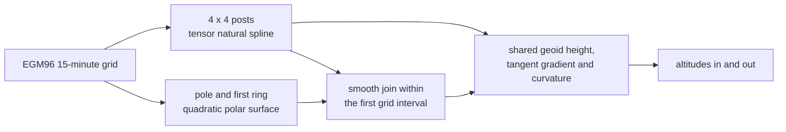

# Geoid

Pharos uses heights above the EGM96 geoid for its position outputs and
static coordinates. Trajectory plans explicitly select `EGM96` or
`ellipsoid` as their altitude reference. Ellipsoidal height is geoid
altitude plus the geoid height under the point. This page covers the
grid, its interpolation and where altitudes are used.

## The grid and its interpolation

The grid is NGA's 15-minute geoid height grid, 721 rows of 1440 posts,
held to the millimetre. Outside the first interval next to either pole,
the height comes from the 4 x 4 posts around the point. A natural cubic
spline runs along each row, then one across the four results, as the
grid's distribution documents.

| Case | Rule |
|---|---|
| at the prime meridian | the window wraps by the posts' true longitudes |
| within 0.125° of either pole | a quadratic in the horizontal components of the unit surface normal |
| between 0.125° and 0.25° of either pole | a quintic blend joins the quadratic to the tensor spline |
| at a stored grid post | the stored height is retained |
| within a cell | the height is smooth, with a slope and a curvature |

Each polar quadratic keeps the pole height and fits the first neighboring
ring's mean and first two longitude harmonics. Its coefficients are derived
from the embedded grid. The blend matches height, gradient and curvature
at both boundaries. The polar surface has one finite gradient and curvature
at the pole, independent of a longitude convention.

Altitude conversions and trajectory building use the same height surface.
Over EGM96 a straight's or a turn's altitude is its height above it, and
the limits read the altitude, climb rate and vertical acceleration above
it, each point in the grid cell it lies in. An altitude limit in an EGM96
plan therefore bounds height above this surface. A level leg's knots fall
where its track crosses the grid's lines, where the surface's slope steps
the leg's velocity.

## Where altitudes are used

| Place | Altitude |
|---|---|
| trajectory plans | the places' altitudes, a straight's and a turn's vertical motion and the altitude limits use the plan's explicit `EGM96` or `ellipsoid` reference; an along's heights pass its guide's places |
| `pharos-traj static` | the altitude given with `--lla` |
| LLA position files | the output height column above the geoid |
| KML files | `absolute` altitudes above the geoid |
| `pharos-traj check` and `info` | the altitude range and the end positions |
| the C trajectory API | the altitude of `pharos_traj_static` and of `pharos_traj_state` |
| plan inspection | the plan's selected altitude reference |
| the troposphere | not used: GPT3 carries its own undulation |

## Standards

| Product | Issue | Used for |
|---|---|---|
| EGM96 geoid (NGA) | the 15-minute geoid height grid WW15MGH.GRD of 1996-12-19 | EGM96 plan geometry and vertical motion; geoid altitude outputs; KML altitudes |

The grid is embedded with its size checked at compile time and the
SHA-256 of the published file recorded.
