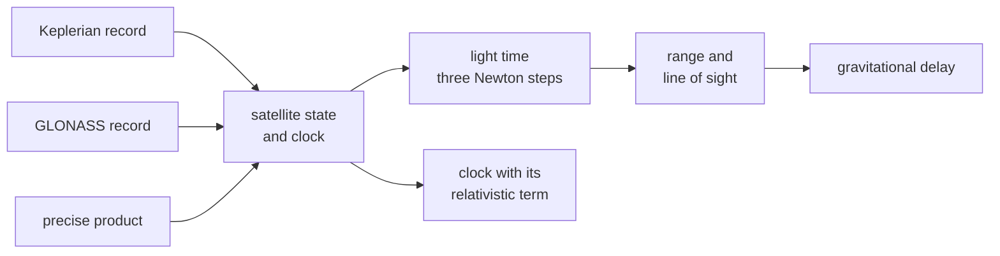

# Geometry

This page covers where the satellite is and when its signal left. It
covers the orbit and clock sources, the relativistic clock term, the
light time and the gravitational delay. It ends with the conventions of
a precise product and the datums.



## Orbits and clocks

| Source | Orbit | Clock | Relativistic term |
|---|---|---|---|
| Keplerian record | the ICD's Keplerian propagation; five Newton steps for the eccentric anomaly | the record's polynomial, plus its system's declared offset to GPS time | F e sqrt(A) sin E, from the propagation |
| GLONASS record | the ICD's Earth-fixed equations with J2 and the broadcast luni-solar accelerations held constant; RK4 in 1 s steps from tb | -tau_n plus gamma_n times the time since tb, plus the declared offset | none |
| precise product | Lagrange interpolation over 10 samples; two neighbouring windows blended | linear between the two samples around the instant | -2 r.v / c^2 |

| Source | Follows |
|---|---|
| GPS orbit and constants | IS-GPS-200 Table 20-IV |
| clock polynomial | IS-GPS-200 20.3.3.3.3.1, and each ICD's own |
| Galileo orbit | OS SIS ICD 5.1.1 |
| BDS orbit, with the GEO rotation | BDS-SIS-ICD-B1I 5.2.4.12 |
| GLONASS orbit | GLONASS ICD 5.1 Appendix 3 |

A Keplerian record is propagated from parameters derived once; its state
at an instant is a pure function. The GLONASS integration keeps its last
64 whole steps: an instant farther from t_b continues from the last of
them, one among them starts from its own, and only one nearer to t_b than
all of them integrates again from t_b. Every source is interpolated
between knots a second apart: position and velocity, clock bias and drift
as cubic Hermite pairs, using the shared trajectory Hermite basis.
`geo.Window` owns these endpoints and provider advancement. Complete
observations use `geo.Observation`, which advances the geometry and its
corrections together and exposes read-only frames for evaluation.

## Light time

The transmit time comes from three Newton iterations on the light time,
starting from the straight-line estimate and reusing the already
evaluated satellite state at the receiver time. The satellite's state at the
transmit time is rotated about the Earth's axis. The angle is exactly
what the Earth turns during the light time. Each system uses its own
rotation rate. No history carries from one epoch to the next.

Elevation and azimuth come from the receiver's east-north-up frame on
the WGS 84 ellipsoid. The receiver frame is prepared once for an instant
and shared by its satellite evaluations.

## The gravitational delay

The ray carries the Shapiro delay of the Earth's monopole:

```
(2 GM / c^2) ln((r_sat + r_rx + rho) / (r_sat + r_rx - rho))
```

r_sat and r_rx are the geocentric distances and rho the range. The delay
follows IERS Conventions (2010) 11.1, with GM of Table 1.1. It is
computed in closed form from the light-time result, and it is common to
code and carrier.

## Precise products

| Convention | Rule |
|---|---|
| orbit | the product's positions are the centre of mass |
| clock | the product's clocks refer to an ionosphere-free pair: `clockReference`, else the system's default |
| default pairs | P1P2 for GPS, B1IB3I for BDS, E1E5a for Galileo, G1G2 for GLONASS |
| a component's delay | its common resolved group delay less the pair's offset D = (f1^2 d1 - f2^2 d2) / (f1^2 - f2^2) |
| GPS | the broadcast delays already refer to P1P2, so D is zero |
| a binding lacking a data delay of the pair after resolution | the satellite is dark during that binding; the packer warns |
| relativistic term | not in the product's clocks; applied as -2 r.v / c^2 |
| with an ANTEX file | the orbit moves from the centre of mass to the pair's phase centre, under the attitude law |
| coverage | a satellite the product does not cover over the selection span is dark |

The selection keeps the broadcast binding for health, window, common
delays and the GLONASS frequency. The raw reference still identifies the
clock basis; its resolved family attributes do not change that basis.
Only the orbit and clock come from the product. See
[navigation](../design/navigation.md).

## Not modelled

| Item | Why |
|---|---|
| the Earth's oblateness and the Sun's and Moon's fields in the gravitational delay | only the Earth's monopole is carried |
| a receiver antenna, receiver clock error and measurement noise | the receiver is a point at its phase centre and the truth the samples realise; the samples carry the noise |

## Standards and datums

| Document | Issue | Used for |
|---|---|---|
| IERS Conventions (2010) | 11.1, in "General relativistic models for propagation"; GM of Table 1.1 | the gravitational delay |
| IGS products | as the format descriptions and the HAS SIS ICD 7.3 state them | centre-of-mass orbits, clocks on the ionosphere-free pair, the relativistic term |
| WGS 84, GTRF, CGCS2000 | as each system's ICD states them | each system's orbit constants |
| PZ-90.02 | GLONASS ICD 5.1, with its algorithms' own constants of A.3.1.2 | the GLONASS orbit; records are used in the frame they are broadcast in, untransformed |

## Limits

| Check | Domain |
|---|---|
| Keplerian eccentricity | 0 to 0.5 |
| Keplerian semi-major axis | 10 000 km to 50 000 km |
| GLONASS orbital period | 39 600 s to 46 800 s |
| GLONASS eccentricity | at most 0.03 |
| GLONASS inclination | within 0.067 pi rad of 63 degrees |
| product clock samples | at most 1800 s apart to be bridged |
| product positions | at most 50 000 km from the geocentre |
