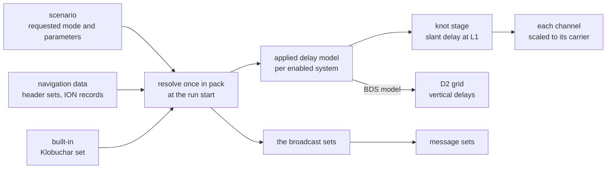

# Ionosphere

The ionosphere delays the code and advances the carrier by the same
amount. The scenario's `ionosphere` key names one model for all systems,
or `auto` to choose by constellation ([scenarios](../guide/scenarios.md)).
The packer resolves the applied models, coefficients and sources once at
the run start and stores them beside the message families' broadcast
sets. These choices stay fixed for the whole run. Runtime construction
uses a table of models by system and shares one NeQuick G data allocation
when that model is needed.

## The models

| Model | `model` | Follows | Shape | Coefficients |
|---|---|---|---|---|
| GPS Klobuchar | `klobuchar` | IS-GPS-200N 20.3.3.5.2.5 | a thin shell at 350 km | 8 |
| BDS Klobuchar | `bdsKlobuchar` | BDS-SIS-ICD-B1I 5.2.4.7 | a thin shell at 375 km | 8 |
| NeQuick G | `nequick` | the European Commission's NeQuick G document | the electron density integrated along the ray | 3 |
| BDGIM | `bdgim` | BDS-SIS-ICD-B1C 7.8.2, Tables 7-11 and 7-12 | a thin shell at 400 km | 9 |
| none | `none` | | no delay | 0 |

The default remains `klobuchar`: every system uses GPS Klobuchar with the
same coefficients. Any concrete model named explicitly applies to all
enabled systems in the same way. `auto` is a selection mode and accepts
no `parameters`.

The GPS model runs on GPS time of week, the BDS model on BDT. BDGIM adds
the ICD's non-broadcast coefficients to the
nine broadcast ones. NeQuick G uses the document's data files and
quadrature. It reads UTC from the built-in leap table, because the model
takes UTC as a measure of the Earth's rotation.

## Coefficients and fallbacks

For an explicit concrete model:

| Model | First | Then | Then |
|---|---|---|---|
| GPS Klobuchar | the scenario's `parameters` | the navigation data | the built-in set |
| BDS Klobuchar, NeQuick G, BDGIM | the scenario's `parameters` | the navigation data | none: the packer refuses the scenario |

With `model: "auto"`, each system with a listed signal uses:

| System | Applied model and coefficient source |
|---|---|
| GPS | the navigation data's GPS Klobuchar set, else the built-in GPS set |
| Galileo | the navigation data's NeQuick G set; missing data is a pack error |
| BDS | the navigation data's BDGIM set, else its BDS Klobuchar set; missing both is a pack error |
| GLONASS | GPS Klobuchar as a substitute: the navigation data's GPS set, else the built-in GPS set |

BDS selection uses actual navigation sets. The GPS-set fallback in a
D1/D2 message and the zero coefficients in a B-CNAV message do not qualify
as an automatic delay model. The supported GLONASS FDMA navigation has
no dedicated ionosphere model; logs and the manifest report GPS
Klobuchar for GLONASS. Allocation and satellite masks do not change
which systems `auto` resolves.

The navigation data give the latest set transmitted by the run start.
Without one, they give the first header set that fits its broadcast
fields. A header set outside its fields is dropped with a warning. The
file rules are in [navigation data](../guide/navigation-data.md). With all
three NeQuick G coefficients zero, the model takes the document's default
level.

A scenario with only position output needs no ionosphere model. Its
bundle marks this processing inactive. An active model of `none` still
supplies the broadcast sets in the table below.
The parser rejects `parameters` with `auto` even for position-only output
and even when the array is empty.

## Frequency and domain

Every satellite uses its system's applied model for all its frequencies.
That model gives the slant delay at L1, 1575.42 MHz. A channel scales it
by the square of the ratio of L1 to its carrier. A GLONASS channel uses
its satellite's own frequency. The BDS model is computed at B1I, then
moved to L1 the same way.

| Case | Thin-shell models | NeQuick G |
|---|---|---|
| a ray below the horizon | taken at the horizon | integrated along the ray |
| a receiver above the shell | no delay | integrated from the receiver's height |
| a ray through the Earth | | no delay |

`core.iono.Prepared` holds one model's receiver and time context at an
observation endpoint. `geo.Observation` prepares the applied models once
per endpoint, then evaluates the satellite rays. NeQuick G preparation
includes the receiver, effective ionisation level, solar context and
CCIR epoch; integration remains specific to each ray. BDGIM preparation
uses a cached set of 17 prediction coefficients for its two-hour window.

The delay is evaluated at the knots, once a second, for every selected
satellite. An epoch takes the chord between two knots. The D2 grid's
vertical delays use the BDS slot's applied model at each grid point,
scaled to B1I.

## What the messages broadcast

| Family | Set | When none is given |
|---|---|---|
| LNAV, CNAV, CNAV-2 | GPS Klobuchar | the built-in set |
| D1/D2 | BDS Klobuchar | the GPS set, possibly the built-in one |
| B-CNAV1, B-CNAV2, B-CNAV3 | BDGIM | zeros |
| I/NAV, F/NAV | NeQuick G | zeros, which the document reads as the default level |

The applied delay model and each family's broadcast set are separate.
An explicit coefficient override replaces the corresponding broadcast
set as well. When a system's applied model is the one a family broadcasts,
that family sends the coefficients used for its delays. Under `auto`,
BDS can apply BDGIM while D1/D2 continues to carry its Klobuchar set.

## Standards

| Document | Issue | Used for |
|---|---|---|
| Ionospheric Correction Algorithm for Galileo Single Frequency Users (European Commission) | 1.2, September 2016 | NeQuick G: ionisation level, MODIP, profile, ray and quadrature; the 13 data files of Annex C, verbatim |

## Limits and messages

| Where | Message |
|---|---|
| pack, `ionosphere.parameters` | the \<model\> model has no coefficients: none here and no set of it transmitted in the navigation data by the run start |
| pack, `ionosphere.model` | auto selected nequick for Galileo, but the navigation data have no coefficients transmitted by the run start |
| pack, `ionosphere.model` | auto requires BDGIM or BDS Klobuchar coefficients for BDS, but the navigation data have neither set transmitted by the run start |
| read, `ionosphere` | the auto ionosphere model takes 0 of parameters; 1 given (parameters) |
