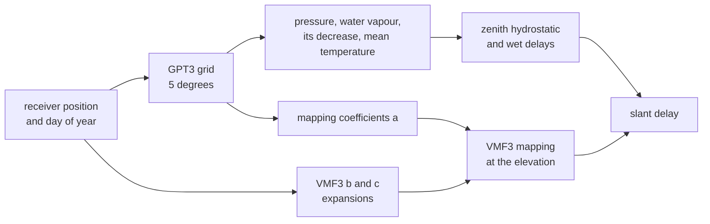

# Troposphere

The troposphere delays code and carrier alike. Every run applies it, so
no scenario key selects it. GPT3 gives the meteorology at the receiver;
VMF3 maps the zenith delays to each ray's elevation.

## The delays

| Part | Model |
|---|---|
| meteorology | GPT3 means with annual and semiannual terms, bilinear between four grid points; near a pole, the nearest point |
| pressure at the receiver | reduced from the grid point's height with the grid's lapse rate up to the tropopause, then isothermal |
| zenith hydrostatic delay | from the pressure, with gravity at the site's latitude and height |
| zenith wet delay | from the water vapour pressure, its decrease factor and the mean temperature |
| mapping | VMF3 hydrostatic and wet functions: a from GPT3; b and c from expansions to degree and order 12 |
| height | the hydrostatic mapping's height correction |

The lapse rate held to the tropopause gives a receiver well above the
ground a real pressure. GPT3 carries its own geoid undulation and
orography, so the EGM96 geoid does not enter the delay.

A site holds everything but the ray's elevation. One site per receiver
instant serves every satellite. The knot stage builds a site at both ends
of each second; an epoch takes the chord between two knots.

## The horizon and the floor

| Elevation | Delay |
|---|---|
| at or below the horizon | none |
| between the horizon and 3 degrees | the delay at 3 degrees |
| above 3 degrees | mapped at the elevation |

The mapping functions are given from 3 degrees upward. Below that the
height correction grows without limit.

## Embedded data

| Data | Kept as |
|---|---|
| the GPT3 5 x 5 degree grid, gpt3_5.grd | per grid point, the columns from the pressure to the mean temperature, as scaled integers |
| the VMF3 b and c coefficients | little-endian doubles, with annual and semiannual terms |

Both are kept exactly. Their sizes are checked at compile time, and the
SHA-256 of each published file is recorded. The grid's gradient columns
are not kept.

## Not modelled

| Item | Why |
|---|---|
| weather and horizontal gradients | GPT3 is a climatology of means with annual and semiannual terms; the gradient columns are not read |
| the troposphere below 3 degrees | the height correction leaves its domain there; such a ray carries the delay at 3 degrees |

## Standards

| Product | Issue | Used for |
|---|---|---|
| GPT3 (the VMF Data Server of TU Wien) | gpt3_5.grd of 2018-04-20 | the meteorology and the mapping coefficients a |
| VMF3 (the VMF Data Server of TU Wien) | the b and c coefficient tables of 2019-03-25 | the mapping functions |

The server's terms ask for two things, given here. The data are cited as
re3data.org: VMF Data Server, doi:10.17616/R3RD2H. GPT3 and VMF3 rest on
the numerical weather models of ECMWF, which are acknowledged.
